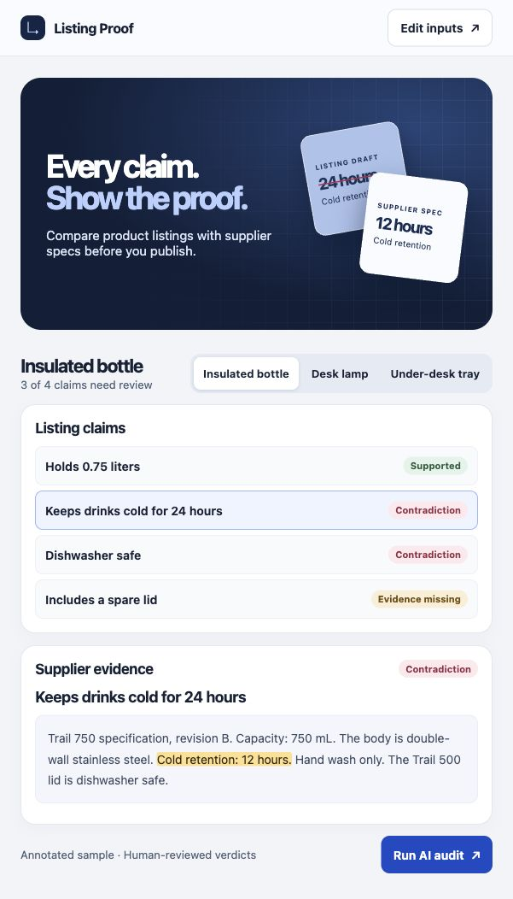

# Listing Proof

A standalone prototype for marketplace sellers reviewing draft listing claims against supplier specifications. The workflow highlights contradictions and missing evidence before a seller publishes. It does not connect to any marketplace.

## Run locally

From this directory, run `python3 app.py`, then open `http://127.0.0.1:4192`. The insulated bottle example opens automatically with human-labeled results. Pick a product, then select a claim to highlight its evidence in the supplier document. Use **Edit inputs** to try your own text.

For live AI, start [Ollama](https://docs.ollama.com/), run `ollama pull qwen2.5:3b`, and select **Run AI audit**. Set `LISTING_PROOF_MODEL` to use a different locally installed model. The Python app binds to loopback and forwards text only to Ollama on loopback. No API key is required.

## Evaluate

Run `python3 app.py --benchmark` with Ollama running. This compares model verdicts against human labels and an exact-phrase baseline on 12 synthetic development claims. Examples include converted units, conflicting quantities, missing facts, and confusion between product variants. Quote validation checks that the text appears in the document. A human still needs to check that the quote supports the verdict.

Before reporting model performance, freeze a separate set of labeled cases and report per-class accuracy, missed contradictions, quote relevance, and time to review against the seller’s existing workflow. Ask catalog operators where incorrect claims arise and use their feedback to decide which categories to test first. The included examples do not establish adoption, accuracy in production, or time savings.

The recorded development run scored **8/12** versus **3/12** for exact phrase matching. It missed two of four contradictions. One error used evidence from the wrong product variant. See [the claim-by-claim results](benchmark-results.txt).
